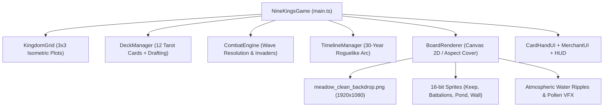

# 9 Kings: Digital Tabletop Web Remake

[](#recent-codenames)
[](#testing)
[](https://www.typescriptlang.org/)
[](https://vitejs.dev/)

An authentic 1:1 web recreation of the tactical tabletop roguelike **9 Kings** (Playdigious / Sad Socket iOS & Steam editions). Built with zero runtime bloat using high-performance HTML5 Canvas 2D and deterministic TypeScript state machines.

---

## Direct Documentation Links

For external tools, web crawlers, or direct terminal reading, the core documentation files are tracked under `docs/`:

- **Operations & Run Manual**: [`docs/WALKTHROUGH.md`](docs/WALKTHROUGH.md)  
  *Raw Link*: `https://raw.githubusercontent.com/HoledkRTF/nine-kings-web/master/docs/WALKTHROUGH.md`
- **Surgical Backdrop Progress Report**: [`docs/PROGRESS_REPORT.md`](docs/PROGRESS_REPORT.md)  
  *Raw Link*: `https://raw.githubusercontent.com/HoledkRTF/nine-kings-web/master/docs/PROGRESS_REPORT.md`
- **Developer Architecture & Handoff**: [`docs/HANDOFF.md`](docs/HANDOFF.md)  
  *Raw Link*: `https://raw.githubusercontent.com/HoledkRTF/nine-kings-web/master/docs/HANDOFF.md`

---

## Highlights & Features

- **Discrete 16-bit Dithered Pasture**: 1920x1080 native meadow environment reconstructed with discrete 2x2 retro pixel dither clusters and vertical lighting gradients (`#4E7D68`, `#68A48B`, `#7EBCAC`), eliminating continuous Gaussian/Poisson blur and ghost artifacts.
- **Surgical Perimeter Wall**: Seamless disc healing along cobblestone wall trajectory vectors (`dx=70, dy=-35`), restoring authentic pine trees and continuous masonry.
- **2.5D Isometric Diamond Grid**: Mathematical 2:1 isometric projection (`tileW = 120px`, `tileH = 68px`) with exact subpixel diamond hit testing.
- **Tarot Card Hand Engine**: 12 specialization cards, 3D cursor-hover tilt physics, and the core "Leave Two" placement rule.
- **30-Year Roguelike Timeline**: Full campaign pacing with invasion waves, boss encounters (Years 8, 23, 30), and merchant draft phases.
- **Local Folder Branching Protocol**: Strict git simulation across `main/`, `staging/`, `dev/`, and `features/`.

---

## Quickstart

### Prerequisites
- Node.js 18+ and npm 9+
- Python 3.10+ (for background image processing pipelines)

### Setup & Run
```bash
# Clone the repository
git clone https://github.com/HoledkRTF/nine-kings-web.git
cd nine-kings-web

# Install dependencies
npm install

# Launch local dev server (default port 3000)
npx vite dev dev --port 3000
```
Open your browser to `http://localhost:3000`.

---

## Testing & Verification

The project enforces deterministic unit tests for every core system (rendering, timeline, cards, combat, math):

```bash
# Full test suite (163 tests)
npx vitest run dev/

# Targeted renderer unit test
npx vitest run dev/src/render/board-renderer.test.ts

# Production build test
npx vite build dev
```

---

## Architecture



---

## Branching & Release Strategy

1. `main/`: Sacred production release. Untouchable during development.
2. `staging/`: Dress rehearsal testing ground for pre-production verification.
3. `dev/`: Active development integration branch.
4. `features/`: Isolated task folders (e.g. `features/nine-kings-ios-background/`).

---

## Recent Codenames

- `Sovereign-Pasture`: Authentic 1:1 9 Kings meadow environment, surgical removal of blur artifacts with discrete 16-bit dithered pixel grass, healed left wall and spruce forest, and aspect-cover canvas scaling.
- `Verdant-Sovereign`: 1920x1080 Steam-extracted pasture with cobblestone wall, 12 authentic 16-bit Tarot cards, Royal Keep, and battalion count badges.
- `Pine-Dominion`: Authentic 9 Kings official environment recreation with diagonal cobblestone wall, conifer spruce pine trees, cyan pond, and stone well.
- `Crown-Diorama`: 2.5D isometric tabletop diorama overhaul with extruded cliffside depth, 16-bit pixel buildings, and Web Audio synthesis.
- `Shadow-Glide`: Camera jitter fix and fast-action dash physics.
