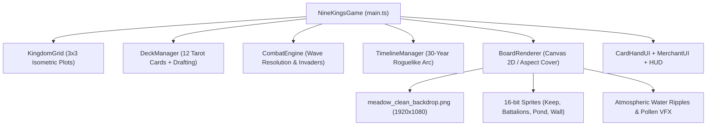

# Developer Handoff: 9 Kings Digital Tabletop Remake

## 1. System Architecture Overview



The game is structured as a zero-dependency, high-performance HTML5 Canvas & TypeScript application built on Vite. State management is strictly deterministic and test-driven.

---

## 2. Local Folder Branching Strategy

To simulate Git branching locally without dirtying production code:
- `main/`: Sacred production release. Untouchable during development.
- `staging/`: Dress rehearsal testing ground for pre-production builds.
- `dev/`: Active development integration branch.
- `features/`: Isolated feature branches (e.g. `features/nine-kings-ios-background/`).

### Promotion Protocol:
1. Work in `features/<feature-name>/`.
2. When complete, copy feature over `dev/`.
3. Verify all 163 unit tests pass (`npx vitest run dev/`).
4. Copy `dev/` over `staging/`, build and verify tests.
5. Create a `.zip` backup of `main/` (`main_backup_<date>.zip`).
6. Copy `staging/` over `main/`, build and run full test suite.
7. Assign a memorable **Codename** tag (e.g., `git tag Sovereign-Pasture`).

---

## 3. Rendering Pipeline & Math

### Isometric Coordinate Math
The kingdom uses standard 2.5D isometric diamond projection:
- **Tile Dimensions**: `tileW = 120px`, `tileH = 68px` (2:1 aspect ratio).
- **Cartesian to Screen**:
  $$\text{pixelX} = \text{originX} + (gx - gy) \cdot \frac{\text{tileW}}{2}$$
  $$\text{pixelY} = \text{originY} + (gx + gy) \cdot \frac{\text{tileH}}{2}$$
- **Screen to Cartesian (Hit-Testing)**:
  $$dx = \text{screenX} - \text{originX}$$
  $$dy = \text{screenY} - \text{originY}$$
  $$gx = \left\lfloor \frac{dx}{\text{tileW}} + \frac{dy}{\text{tileH}} + 0.5 \right\rfloor$$
  $$gy = \left\lfloor \frac{dy}{\text{tileH}} - \frac{dx}{\text{tileW}} + 0.5 \right\rfloor$$

### Background Aspect-Cover Scaling
To ensure pixel-perfect rendering across varying browser aspect ratios without letterboxing:
```typescript
const scale = Math.max(width / imgW, height / imgH);
const drawW = imgW * scale;
const drawH = imgH * scale;
const drawX = (width - drawW) / 2;
const drawY = (height - drawH) / 2;

ctx.imageSmoothingEnabled = false; // Nearest-neighbor scaling
ctx.drawImage(this.bgImage, drawX, drawY, drawW, drawH);
```

---

## 4. Key Subsystems

### 4.1 Deck & Card Slinging (`src/cards/deck.ts` & `src/ui/card-hand-ui.ts`)
- **Starter Deck**: 12 cards tailored to King specialization (default: King of Nothing).
- **Rule of Hand ("Leave Two")**: The player draws cards each year and must place cards on the 3x3 grid until exactly **2 cards remain in hand** before the battle can begin.
- **Card Aspect Ratio**: Fixed 1:1.45 Tarot proportion with 3D cursor-hover tilt physics.

### 4.2 Timeline Progression (`src/battle/timeline.ts`)
- **30-Year Roguelike Campaign**:
  - Year 8: War Milestone (Boss Invasion).
  - Year 23: Peace Milestone / Diplomatic Choice.
  - Year 30: Final Boss Confrontation.
  - Merchant Visits: Triggered at predetermined milestone years.

### 4.3 Combat & Battalions (`src/battle/combat-engine.ts`)
- Invaders march from perimeter perimeter towards the central Royal Keep.
- Defensive towers (Trebuchet, Scout Tower, Dispenser) acquire targets using Chebyshev / Manhattan distance.
- Troop count badges update in real-time with combat damage floating numbers.

---

## 5. Next Sprint Milestones

1. **Card Hand UI Physics Polish**:
   - Enhance the card-slinging gesture with drag-and-drop spline trajectories and tactile release snapping onto the 3x3 grid.
2. **Battalion Swarm Boids & Combat Juice**:
   - Implement localized flocking/boids separation for troop swarms with screenshake decay on impact and particle death bursts.
3. **King Active Spells Implementation**:
   - Wire up the 4 left relic buttons (`Rally Horn`, `Frost Ward`, `Arcane Surge`, `War March`) to trigger board-wide tactical buffs with animated screen overlays.
